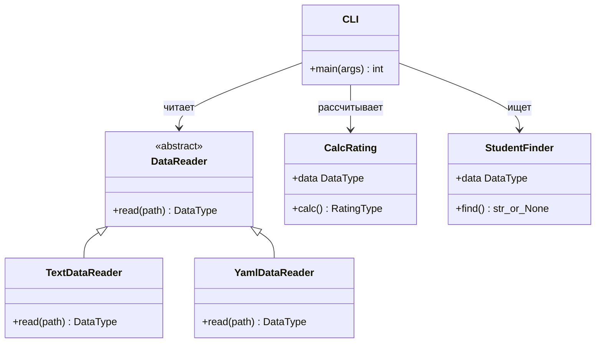

# Лабораторная № 1 · Вариант 9

[](https://github.com/asartem9855/PTLab1/actions/workflows/ci.yml)

**Дисциплина:** Технологии программирования. **Автор:** Артём Плешаков.

## Постановка задачи

Освоить Git, ООП, модульное тестирование и GitHub Actions. Дополнить
учебную программу расчёта среднего рейтинга чтением YAML и поиском студента,
имеющего **ровно 90 баллов по всем дисциплинам**. При нескольких совпадениях
выводится первый студент в порядке файла, при отсутствии — понятное сообщение.
Средний балл 90 сам по себе не подходит: оценки 80 и 100 не выполняют условие.

## Запуск

Python 3.11–3.13. Из папки `Lab1/rating` в PowerShell:

```powershell
..\..\.venv\Scripts\python.exe -m pip install -r requirements.txt
..\..\.venv\Scripts\python.exe -m src.main -p data/data.yaml
..\..\.venv\Scripts\python.exe -m src.main -p data/data.txt
```

На другом компьютере сначала создайте окружение: `python -m venv .venv`.
Затем используйте `.venv\Scripts\python.exe` (Linux: `.venv/bin/python`).

Пример результата для приложенных данных:

```text
Иванов Иван Иванович: 90.00
Петров Пётр Петрович: 90.00
Сидорова Анна Сергеевна: 84.00
Студент с 90 баллами по всем дисциплинам: Иванов Иван Иванович
```

## Формат данных

`data/data.yaml` соответствует примеру методички:

```yaml
- Иванов Иван Иванович:
    математика: 90
    программирование: 90
```

Поддерживаются `.yaml`, `.yml`, `.txt` (UTF-8, в том числе BOM).
Для YAML также допустим единый словарь студентов. Оценки — целые числа 0–100;
пустые имена, отсутствие дисциплин, повторы и неверные типы отклоняются.
Пустой файл означает отсутствие студентов. YAML читается безопасным загрузчиком:
создание произвольных Python-объектов запрещено, дубли ключей не затираются.
Ошибки ввода завершают CLI кодом 1, неверные аргументы — кодом 2.

## Структура и UML

| Компонент | Назначение |
|---|---|
| `src/DataReader.py` | Абстрактный интерфейс чтения |
| `src/TextDataReader.py` | TXT из исходного задания |
| `src/YamlDataReader.py` | YAML для варианта 9 |
| `src/CalcRating.py` | Среднее арифметическое оценок |
| `src/StudentFinder.py` | Поиск студента по точному условию |
| `src/validation.py` | Единые ограничения входных данных |
| `src/main.py` | CLI, выбор формата и вывод |
| `test/` | Модульные тесты |



## Тестирование и CI/CD

```powershell
..\..\.venv\Scripts\python.exe -m pycodestyle src test
..\..\.venv\Scripts\python.exe -m pytest --cov=src --cov-branch --cov-report=term-missing --cov-report=html --cov-fail-under=95
```

58 тестов: чтение файлов, повторное использование reader, все ветви проверки
данных, границы оценок, точное равенство 90, несколько/ноль кандидатов,
небезопасный YAML, ошибки CLI. Измеренное покрытие строк и ветвлений — около 99%.
HTML-отчёт после тестов: `htmlcov/index.html`.

GitHub Actions (`.github/workflows/ci.yml`) запускает PEP8, тесты с порогом
покрытия 95% и пример CLI на Python 3.11, 3.12, 3.13 при push/PR.
После успеха в `main` формируется архив `lab1-variant9` (continuous delivery).
Отчёты находятся в Actions → запуск → Artifacts. Сервер для консольной программы
не требуется. Отдельная ветка `demo/ci-failure` демонстрирует обнаружение ошибки
и её исправление; ошибочный код не попадает в `main`.

Разработка читателя и расчётного класса выполнена в отдельных ветках
`feature/yaml-reader` и `feature/variant9-search`, со слиянием `--no-ff`
после успешных проверок. Историю удобно смотреть командой
`git log --graph --oneline --all`.

## Что показать на защите

1. Условие варианта и YAML, запуск команды выше.
2. Заменить одну оценку Иванова на 91 во временной копии файла и получить
   сообщение об отсутствии подходящего студента.
3. UML, наследование от `DataReader`, реализацию `all(score == 90 ...)`.
4. `pytest`, отчёт покрытия и зелёный запуск Actions.
5. Ветки Git и красный/зелёный запуск демонстрации ошибки.

## Выводы

Реализовано расширение ООП-программы через общий интерфейс без изменения
алгоритмов расчёта. Тесты различают точное выполнение условия и совпадение
среднего рейтинга. Git сохраняет этапы разработки, CI проверяет каждый push,
а доставка архива выполняется только после успешных тестов.

## Кратко к теории

Git — распределённая СКВ: локально хранит историю, ветки и коммиты. `clone`
копирует репозиторий, `add` помещает изменения в индекс, `commit` фиксирует
снимок, `push` передаёт коммиты на сервер. Рабочая копия, индекс и история —
разные состояния. CI автоматически интегрирует и проверяет изменения; CD
доставляет проверенный результат или разворачивает его. GitHub Actions
описывает события, jobs и steps в YAML. MIT — разрешительная лицензия,
сохраняющая уведомление об авторстве; GPL требует соблюдения copyleft;
Apache-2.0 дополнительно содержит патентные положения.

## Источники

Методичка `TP_Lab1_CI_CD_GitHub.pdf` (2022), с. 11–13;
[PyYAML](https://pyyaml.org/wiki/PyYAMLDocumentation),
[pytest](https://docs.pytest.org/), [Git](https://git-scm.com/docs),
[GitHub Actions](https://docs.github.com/en/actions).
Выбрана лицензия MIT, см. `LICENSE`.
